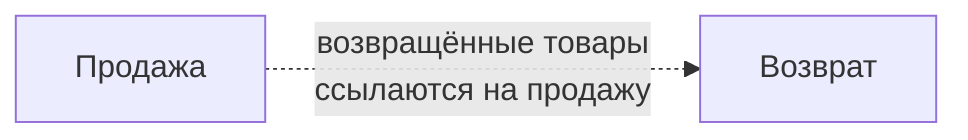
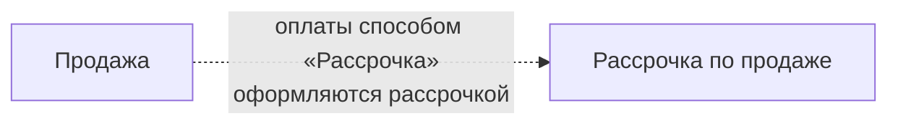

---
covers:
  - src/configuration/goods.ts
  - src/configuration/payments.ts
  - src/configuration/installments.ts
  - src/configuration/documents/sale.document.ts
  - src/configuration/documents/installment.document.ts
  - src/configuration/documents/sale-installment.document.ts
  - src/configuration/documents/weighing.document.ts
  - src/configuration/documents/refund.document.ts
  - src/configuration/registers/sales.register.ts
  - src/configuration/registers/customer-settlements.register.ts
  - src/configuration/registers/money-receipts.register.ts
  - src/configuration/registers/sale-installments.register.ts
---

# Правила учёта

Справочник предназначен для проверки расчётов и условий учёта магазина. Он описывает суммы, скидки, состояния документов и ограничения операций. Устройство платформы, состав полей, формы и порядок работы сотрудников описываются отдельно.

## Общие правила

Продажа, рассрочка и отвес относятся к смене, в которой оформлены. Результат смены считается по её продажам и рассрочкам, поэтому последующие события относятся к смене, которая продала или отвесила, а не к смене, в которую они произошли:

| Событие | Смена в учёте |
|---|---|
| Возврат | Смена продажи, по которой возвращён товар; смена в самом возврате показывает, когда он оформлен |
| Взнос по рассрочке | Долг уменьшается в смене рассрочки; деньги взноса относятся к смене, в которую его приняли, а без открытой смены к смене рассрочки |
| Продажа из отвеса | Смена отвеса; до проведения смену в продаже можно изменить |

Итог закрытой смены поэтому может измениться после её закрытия: его уменьшает возврат по её продаже и увеличивает выкуп из её отвеса.

Продажи, рассрочки и отвесы учитываются раздельно. Суммы рассрочек и отвесов не входят в сумму продаж. Выкуп товара из отвеса создаёт самостоятельную продажу, а оплата рассрочки продажу не создаёт.

Правило о суммах относится к обычной рассрочке, которая оформляется вместо продажи и хранит свои товары. [Рассрочка по продаже](#рассрочка-по-продаже) закрывает часть оплаты продажи: её товары записаны в продаже и входят в сумму продажи.

Возврат относится к продажам, указанным в его строках. Он ограничивает сумму последующих возвратов, но не изменяет исходные продажи и не уменьшает рассрочки.

При создании продажи из отвеса и добавлении товара в возврат из продажи-основания код и комментарий копируются вместе с товаром. Отметка «Проведено в 1С» в новой строке снята: новый документ ещё не внесён в 1С. Отметка исходной строки сохраняется.

Проведённые продажа, возврат и рассрочка записывают свои суммы в регистры; непроведённый документ в учёте не участвует. Пределы возврата и взносов проверяются по итогам регистров. Продажа записывает ещё и свои оплаты: по ним считаются деньги смены по способам оплаты. Состав движений описан в разделе [«Движения по регистрам»](#движения-по-регистрам).

## Суммы

Для товаров продажи, рассрочки, отвеса и возврата действует один расчёт:

| Величина | Правило |
|---|---|
| Деньги | Считаются в копейках |
| Стоимость строки | Неотрицательная сумма до скидки |
| Скидка строки | Процент от 0 до 100 с точностью до двух знаков |
| Итог строки до округления | `стоимость × (100 − скидка) / 100` |
| Округление итога | До копейки по арифметическому правилу: половина копейки округляется вверх |
| Сумма строк | Складываются уже округлённые итоги; повторного округления нет |

Примеры расчёта:

| Стоимость | Скидка | До округления | Итог |
|---|---|---|---|
| 10,10 ₽ | 5 % | 9,595 ₽ | 9,60 ₽ |
| 999,99 ₽ | 15 % | 849,9915 ₽ | 849,99 ₽ |

Сумма этих двух строк равна 859,59 ₽. Правило описывает расчёт приложения. Совпадение с конкретной конфигурацией 1С требует отдельной сверки её формул и порядка округления.

## Как читать схемы

Схемы показывают состояния и связи документов. Овал обозначает состояние, прямоугольник обозначает связанный документ. Подпись стрелки называет действие или условие:

- «по товару»: меняется отдельная строка, остальные строки документа сохраняют свои состояния;
- «полностью»: действие или проверка относится к документу целиком;
- пунктирная стрелка: связь с другим документом.

У отвеса состояния «В отвесе», «Продано» и «Вывешено» относятся к строкам товаров; состояние «Отвес закрыт» относится ко всему документу.

## Продажа

Продажа учитывает проданные товары и их оплату. Возвраты по продаже оформляются отдельными документами: исходная продажа при этом не меняется.

| Правило | Условие или расчёт |
|---|---|
| Сумма продажи | Сумма итогов её товаров |
| Несколько возвратов | Допустимы, пока их общая сумма по этой продаже не превышает сумму продажи |
| Изменение суммы проведённой продажи | Отклоняется, если новая сумма меньше суммы проведённых возвратов по ней |
| Отмена проведения и пометка на удаление | Отклоняются, пока по продаже проведён хотя бы один возврат с ненулевой суммой |
| Продажа из отвеса | Самостоятельный документ; изменение продажи не меняет исходный отвес |

Предел проверяется по сумме продажи, а не по отдельным товарам. Полное правило и пример приведены в разделе [«Возврат»](#возврат).

Запреты следуют из того же предела: без движения продажи сумма возвратов по ней превысила бы ноль. Чтобы отменить проведение продажи, сначала отменяют проведение её возвратов.

### Оплата продажи

Продажа хранит способ оплаты и оплаты. У каждой оплаты свой способ, сумма и необязательное значение «Куда оплачено»: приёмник оплат из справочника либо текст до 200 символов. Оплата способом «Рассрочка» означает, что деньги не приняты: на её сумму оформляется [рассрочка по продаже](#рассрочка-по-продаже).

| Правило | Условие или расчёт |
|---|---|
| Способ оплаты продажи | Обязателен: «Наличные», «Безналичные» или «Сложная»; в новой продаже стоит «Наличные» |
| Способ одной оплаты | «Наличные», «Безналичные» или «Рассрочка» |
| Оплата способом «Рассрочка» | Допустима только при способе оплаты продажи «Сложная»; «Куда оплачено» у неё не заполняется |
| Сумма одной оплаты | Больше нуля |
| Оплачено | Сумма оплат продажи |
| Простой способ, «Наличные» или «Безналичные» | Оплата одна, и её способ совпадает со способом продажи |
| Способ «Сложная» | Оплат может быть несколько, у каждой свой способ |
| Сумма оплат проведённой продажи | Равна сумме продажи |
| Продажа с нулевой суммой | Проводится без оплат при любом способе: сумма оплаты не бывает нулевой |
| Продажа из отвеса | Создаётся со способом «Наличные» и одной оплатой на сумму выбранных товаров |

Правила об одной оплате, об оплате способом «Рассрочка» и о равенстве сумм действуют при проведении и при записи проведённой продажи. Непроведённая продажа записывается без этих проверок, как черновик. Отказ называет расхождение: для продажи на 1 200 ₽ с оплатами 700 ₽ и 400 ₽ проведение отклоняется, потому что оплаты меньше суммы продажи на 100 ₽; продажа остаётся записанной и непроведённой.

Способ продажи хранится отдельно, а не выводится из числа оплат: сложная оплата из одной строки неотличима от простой. Простая оплата хранится так же, как сложная, одной оплатой со способом продажи.

У продаж, проведённых до появления оплат, оплат и способа нет. Изменить такую продажу можно только вместе с заполнением способа и оплат на её сумму; до этого её запись отклоняется. В поступления денег такие продажи не входят.

## Рассрочка

Рассрочка учитывает товары, которые покупатель оплачивает взносами. Она не превращается в продажу ни при внесении платежа, ни при закрытии.

Правила этого раздела, кроме суммы и обязательности типа и физического лица, действуют и для [рассрочки по продаже](#рассрочка-по-продаже).

| Правило | Условие или расчёт |
|---|---|
| Сумма рассрочки | Сумма итогов её товаров |
| Остаток | `сумма рассрочки − сумма взносов` |
| Тип и физическое лицо | Обязательны при каждой записи |
| Ответственный сотрудник | У собственной рассрочки обязателен при каждой записи; у банковской может отсутствовать |
| Взнос | Способ «Наличные» или «Безналичные», положительная сумма и необязательное «Куда оплачено», как у [оплаты продажи](#оплата-продажи); сумма всех взносов проведённой рассрочки не больше её суммы |
| Смена взноса | Взнос запоминает смену, открытую в момент взноса; без открытой смены он принимается с пустой сменой. Долг взнос уменьшает в смене рассрочки, а деньги относятся к смене взноса; у взноса без смены к смене рассрочки |
| Непроведённая рассрочка | Взносов не принимает и не закрывается: сначала её проводят. В списки незакрытых рассрочек не входит |
| Закрытие | Допустимо только при нулевом остатке и с отдельным правом «Закрыть» рассрочки, в том числе при прямой записи даты закрытия |
| Закрытая рассрочка | Не изменяется, не принимает взносов и не помечается на удаление |

Нулевой остаток разрешает закрытие, но не закрывает рассрочку автоматически. Например, для рассрочки на 1 000 ₽ после взноса 600 ₽ остаток составляет 400 ₽. Взнос 500 ₽ отклоняется. После взноса 400 ₽ рассрочку можно закрыть; после закрытия изменить её нельзя.

Собственную рассрочку, записанную до появления правила об ответственном сотруднике, нужно дополнить ответственным перед следующим взносом или закрытием. Иначе запись отклоняется с просьбой указать ответственного сотрудника. Роль «Продавец» разрешает принимать взносы, но не закрывать рассрочку даже после полного погашения.

Предел взносов действует для проведённой рассрочки: при проведении и при каждой её записи. Непроведённая рассрочка записывается без этой проверки, как черновик, и с превышением взносов не проводится.

У взносов, принятых до появления способа, записаны способ «Наличные» и прежний получатель текстом в «Куда оплачено». В поступления денег такие взносы попадают при следующем проведении рассрочки: его выполняет новый взнос либо [перепроведение документов](delivery.md#как-перепровести-документы-после-обновления).

### Рассрочка по продаже

Рассрочка по продаже учитывает часть оплаты продажи, которую покупатель вносит взносами. Товаров у неё нет: они записаны в продаже. Взносы, остаток, закрытие и запреты закрытой рассрочки у неё те же, что у обычной.

| Правило | Условие или расчёт |
|---|---|
| Продажа | Обязательна |
| Сумма | Вводится, больше нуля |
| Неоформленная сумма продажи | `сумма оплат проведённой продажи способом «Рассрочка» − сумма проведённых рассрочек по этой продаже` |
| Предел | Сумма проведённых рассрочек по продаже не больше суммы её проведённых оплат способом «Рассрочка» |
| Оформление | Действие продажи «Оформить рассрочку» создаёт непроведённую рассрочку на неоформленную сумму. Оно требует проведённой продажи, положительной неоформленной суммы и открытой смены |
| Смена | Смена, открытая в момент оформления, а не смена продажи |
| Тип и физическое лицо | Заполняются в созданной рассрочке; обязательны при проведении и при записи проведённой рассрочки |

Предел действует в обе стороны. Рассрочка не проводится на сумму больше неоформленной, в том числе по непроведённой продаже. Проведённую продажу нельзя изменить, отменить её проведение или пометить на удаление так, чтобы проведённые рассрочки превысили её оплаты способом «Рассрочка»: сначала отменяют проведение рассрочек.

Положительная неоформленная сумма допустима: продажа проводится раньше, чем оформляется рассрочка. Одну неоформленную сумму можно закрыть несколькими рассрочками.

Например, продажа на 1 000 ₽ оплачена 400 ₽ наличными и 600 ₽ способом «Рассрочка». После проведения неоформленная сумма равна 600 ₽. Рассрочка на 600 ₽ после проведения уменьшает её до нуля. Изменение суммы этой рассрочки на 700 ₽ и изменение оплаты «Рассрочка» в продаже на 500 ₽ отклоняются.

Предел «не больше стоимости товаров» отдельно не проверяется: он следует из равенства суммы оплат сумме продажи.

## Отвес

Отвес учитывает товары, отложенные для покупателя. Каждая строка имеет своё состояние, поэтому часть товаров можно выкупить, а остальные оставить в отвесе или вернуть в зал.

| Состояние строки | Значение |
|---|---|
| В отвесе | Товар остаётся отложенным для покупателя |
| Продано | Товар включён в продажу, созданную из этого отвеса; строка ссылается на эту продажу |
| Вывешено | Товар вернулся в зал без продажи; ссылки на продажу нет |

| Правило | Условие или расчёт |
|---|---|
| Выкуп | Продать можно строки в состоянии «В отвесе»; выбранные товары копируются в новую продажу. Её [оплата](#оплата-продажи) заполняется наличными на всю сумму и до проведения может быть изменена |
| Связь с продажей | Ссылка на продажу допустима только у строки «Продано»; продажа должна быть оформлена из этого отвеса |
| Смена продажи | Смена отвеса, даже если она уже закрыта; открытая смена для выкупа не нужна |
| Остаток | Сумма итогов строк «В отвесе» |
| Закрытие | Происходит автоматически, когда строк «В отвесе» не осталось |

Закрытие определяется состояниями строк, а не нулевым остатком: товар с нулевой стоимостью тоже может оставаться в отвесе. Например, в отвесе два товара на 600 ₽ и 400 ₽. После выкупа первого создаётся продажа на 600 ₽, а остаток отвеса равен 400 ₽. Если второй товар вывешен, отвес закрывается. Последующее изменение продажи отвес не меняет.

## Возврат

Возврат учитывает товары, возвращённые по одной или нескольким продажам. Каждая его строка ссылается на свою продажу; предел проверяется отдельно по каждой продаже.

| Правило | Условие или расчёт |
|---|---|
| Сумма возврата по продаже | Сумма итогов строк возврата, ссылающихся на эту продажу |
| Доступная сумма по продаже | `сумма проведённой продажи − сумма уже проведённых возвратов по ней`; у непроведённой продажи она равна нулю |
| Предел | Сумма проверяемого возврата по каждой продаже не больше доступной суммы |
| Проверка предела | При проведении и при изменении уже проведённого возврата; непроведённый возврат сохраняется без этой проверки |
| Возврат по непроведённой продаже | Не проводится, если сумма его строк по этой продаже больше нуля |
| Единица ограничения | Сумма по продаже, а не отдельный товар |
| Исходная продажа | Возврат её не изменяет |

Проведённый возврат уменьшает доступную сумму последующих возвратов. При изменении проведённого возврата его новые суммы заменяют прежние в расчёте предела, а не прибавляются к ним.

Например, по продаже на 1 000 ₽ проведён возврат на 600 ₽. Ещё можно вернуть 400 ₽: второй возврат на 500 ₽ не проводится, а на 400 ₽ проводится. Если в документе есть строки по нескольким продажам, превышение предела хотя бы по одной из них отклоняет проведение всего возврата.

## Движения по регистрам

Регистры хранят суммы проведённых документов по сменам. Смена движения равна смене продажи или рассрочки, а не смене события: правило и его причина приведены в разделе [«Общие правила»](#общие-правила).

| Регистр | Документ | Движение |
|---|---|---|
| Продажи | Продажа | Сумма продажи со сменой продажи |
| Продажи | Возврат | По каждой продаже из строк: сумма итогов этих строк с минусом, со сменой этой продажи |
| Поступления денег | Продажа | По каждой оплате, кроме оплат способом «Рассрочка»: сумма оплаты со сменой продажи и способом оплаты |
| Поступления денег | Рассрочка, рассрочка по продаже | По каждому взносу: сумма взноса с датой и способом взноса и сменой взноса; у взноса без смены со сменой рассрочки |
| Расчёты с покупателями | Рассрочка, рассрочка по продаже | Сумма рассрочки со сменой рассрочки; основанием служит сама рассрочка |
| Расчёты с покупателями | Рассрочка, рассрочка по продаже | По каждому взносу: сумма взноса с минусом, с датой взноса и сменой рассрочки |
| Рассрочки по продажам | Продажа | Сумма её оплат способом «Рассрочка», если она больше нуля |
| Рассрочки по продажам | Рассрочка по продаже | Сумма рассрочки с минусом по её продаже |

| Итог | Значение | Ограничение |
|---|---|---|
| «Продажи» по продаже | Сумма, которую по продаже ещё можно вернуть | Не меньше нуля: предел возврата |
| «Продажи» по смене | Продажи смены за вычетом возвратов по ним | Нет |
| «Расчёты с покупателями» по основанию | Непогашенный долг по рассрочке | Не меньше нуля: предел взносов |
| «Расчёты с покупателями» по смене | Непогашенный долг по рассрочкам смены | Нет |
| «Поступления денег» по смене и способу | Деньги, принятые сменой этим способом: оплаты её проведённых продаж и взносы проведённых рассрочек | Нет |
| «Рассрочки по продажам» по продаже | Сумма, на которую рассрочка по продаже ещё не оформлена | Не меньше нуля: предел рассрочек по продаже |

Например, продажа на 1 000 ₽ проведена в смене А, возврат на 600 ₽ оформлен и проведён в смене Б. Итог регистра «Продажи» по продаже и по смене А равен 400 ₽; движений смены Б в регистре нет. Если возврат содержит строки по продажам разных смен, каждая смена получает движение по своим продажам.

Возврат берёт смену продажи в момент своего проведения. Если смену проведённой продажи изменили после возврата, движение возврата остаётся за прежней сменой, пока возврат не провели заново.

«Куда оплачено» в измерения регистра «Поступления денег» не входит: итоги нужны по смене и способу, а приёмник читается из оплаты продажи. Например, продажа на 1 200 ₽ со сложной оплатой 700 ₽ наличными и 500 ₽ безналичными записывает два движения, и итог смены по способу «Наличные» растёт на 700 ₽.

Возврат в «Поступления денег» не записывает: способ возврата денег покупателю в правилах магазина не определён. Поэтому итог регистра показывает принятые деньги без вычета возвратов.

Взнос рассрочки записывает два движения с разными сменами. Например, рассрочка выдана в смене А, взнос 600 ₽ безналичными принят при открытой смене Б. Долг в «Расчётах с покупателями» уменьшается в смене А, а «Поступления денег» получают 600 ₽ безналичными в смене Б.

Отвес движений не записывает: его суммы не связаны с другими документами.
