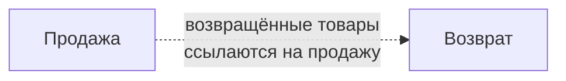
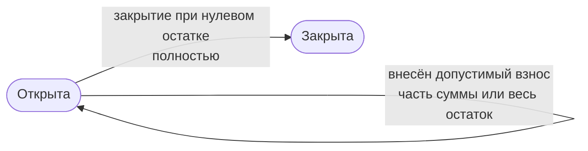
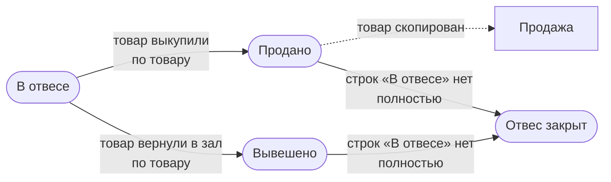
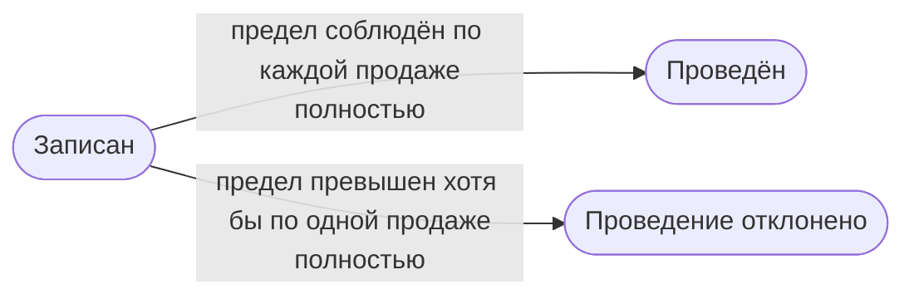

---
covers:
  - src/configuration/goods.ts
  - src/configuration/payments.ts
  - src/configuration/installments.ts
  - src/configuration/period-closing.ts
  - src/configuration/payroll.ts
  - src/configuration/payroll-rules.ts
  - src/configuration/payroll-context.ts
  - src/configuration/period-summary.ts
  - src/configuration/catalogs/installment-rates.catalog.ts
  - src/server/initial-data/own-installment-rate.ts
  - src/configuration/policies/closed-period.ts
  - src/configuration/documents/period-closing.document.ts
  - src/configuration/documents/sale.document.ts
  - src/configuration/documents/sale-installment.document.ts
  - src/configuration/documents/weighing.document.ts
  - src/configuration/documents/refund.document.ts
  - src/configuration/registers/sales-net-of-returns.register.ts
  - src/configuration/registers/installment-debts.register.ts
  - src/configuration/registers/money-receipts.register.ts
  - src/configuration/registers/unarranged-installments.register.ts
---

# Правила учёта

Справочник предназначен для проверки расчётов и условий учёта магазина. Он описывает суммы, скидки, состояния документов и ограничения операций. Устройство платформы, состав полей, формы и порядок работы сотрудников описываются отдельно.

## Общие правила

Продажа, рассрочка по продаже и отвес относятся к смене, в которой оформлены. Результат смены считается по её продажам, поэтому последующие события относятся к смене, которая продала или отвесила, а не к смене, в которую они произошли:

| Событие | Смена в учёте |
|---|---|
| Возврат | Смена продажи, по которой возвращён товар; смена в самом возврате показывает, когда он оформлен |
| Взнос по рассрочке | Долг уменьшается в смене рассрочки; деньги взноса относятся к смене, в которую его приняли, а без открытой смены к смене рассрочки |
| Продажа из отвеса | Смена отвеса; до проведения смену в продаже можно изменить |

Итог закрытой смены поэтому может измениться после её закрытия: его уменьшает возврат по её продаже и увеличивает выкуп из её отвеса.

Продажи и отвесы учитываются раздельно: сумма отвеса не входит в сумму продаж. Выкуп товара из отвеса создаёт самостоятельную продажу.

Товар в рассрочку продаётся продажей с оплатой способом «Рассрочка». Его сумма входит в сумму продажи и в продажи смены. [Рассрочка по продаже](#рассрочка-по-продаже) только учитывает часть оплаты, которую покупатель вносит взносами: товаров у неё нет, а взнос продажу не создаёт.

Возврат относится к продажам, указанным в его строках. Он ограничивает сумму последующих возвратов, но не изменяет исходные продажи и не уменьшает рассрочки по ним.

При создании продажи из отвеса и отметке товара продажи-основания для возврата код и комментарий копируются вместе с товаром. Отметка «Проведено в 1С» в новой строке снята: новый документ ещё не внесён в 1С. Отметка исходной строки сохраняется.

Проведённые продажа, возврат и рассрочка по продаже записывают свои суммы в регистры; непроведённый документ в учёте не участвует. Пределы возврата и взносов проверяются по итогам регистров. Продажа записывает ещё и свои оплаты: по ним считаются деньги смены по способам оплаты. Состав движений описан в разделе [«Движения по регистрам»](#движения-по-регистрам).

## Суммы

Для товаров продажи, отвеса и возврата действует один расчёт:

| Величина | Правило |
|---|---|
| Деньги | Считаются в копейках |
| Стоимость строки | Неотрицательная сумма до скидки |
| Скидка строки | Процент от 0 до 100 с точностью до двух знаков |
| Итог строки до округления | `стоимость × (100 − скидка) / 100` |
| Округление итога | До копейки по арифметическому правилу: половина копейки округляется вверх |
| Сумма строк | Складываются уже округлённые итоги; повторного округления нет |

Примеры расчёта:

| Стоимость | Скидка | До округления | Итог |
|---|---|---|---|
| 10,10 ₽ | 5 % | 9,595 ₽ | 9,60 ₽ |
| 999,99 ₽ | 15 % | 849,9915 ₽ | 849,99 ₽ |

Сумма этих двух строк равна 859,59 ₽. Правило описывает расчёт приложения. Совпадение с конкретной конфигурацией 1С требует отдельной сверки её формул и порядка округления.

## Как читать схемы

Схемы показывают состояния и связи документов. Овал обозначает состояние, прямоугольник обозначает связанный документ. Подпись стрелки называет действие или условие:

- «по товару»: меняется отдельная строка, остальные строки документа сохраняют свои состояния;
- «полностью»: действие или проверка относится к документу целиком;
- пунктирная стрелка: связь с другим документом.

У отвеса состояния «В отвесе», «Продано» и «Вывешено» относятся к строкам товаров; состояние «Отвес закрыт» относится ко всему документу.

## Продажа

Продажа учитывает проданные товары и их оплату. Возвраты по продаже оформляются отдельными документами: исходная продажа при этом не меняется.

| Правило | Условие или расчёт |
|---|---|
| Сумма продажи | Сумма итогов её товаров |
| Несколько возвратов | Допустимы, пока их общая сумма по этой продаже не превышает сумму продажи |
| Изменение суммы проведённой продажи | Отклоняется, если новая сумма меньше суммы проведённых возвратов по ней |
| Отмена проведения и пометка на удаление | Отклоняются, пока по продаже проведён хотя бы один возврат с ненулевой суммой |
| Продажа из отвеса | Самостоятельный документ; изменение продажи не меняет исходный отвес |



Предел проверяется по сумме продажи, а не по отдельным товарам. Полное правило и пример приведены в разделе [«Возврат»](#возврат).

Запреты следуют из того же предела: без движения продажи сумма возвратов по ней превысила бы ноль. Чтобы отменить проведение продажи, сначала отменяют проведение её возвратов.

### Оплата продажи

Продажа хранит способ оплаты и оплаты. У каждой оплаты свой способ, сумма и необязательное значение «Куда оплачено»: приёмник оплат из справочника либо текст до 200 символов. Оплата способом «Рассрочка» означает, что деньги не приняты: на её сумму оформляется [рассрочка по продаже](#рассрочка-по-продаже).

| Правило | Условие или расчёт |
|---|---|
| Способ оплаты продажи | Обязателен: «Наличные», «Безналичные», «Рассрочка» или «Сложная»; в новой продаже стоит «Наличные» |
| Способ одной оплаты | «Наличные», «Безналичные» или «Рассрочка» |
| Оплата способом «Рассрочка» | Допустима при способе оплаты продажи «Рассрочка» или «Сложная»; «Куда оплачено» у неё не заполняется |
| Сумма одной оплаты | Больше нуля |
| Оплачено | Сумма оплат продажи |
| Простой способ: «Наличные», «Безналичные» или «Рассрочка» | Оплата одна, и её способ совпадает со способом продажи |
| Способ «Сложная» | Оплат может быть несколько, у каждой свой способ |
| Сумма оплат проведённой продажи | Равна сумме продажи |
| Продажа с нулевой суммой | Проводится без оплат при любом способе: сумма оплаты не бывает нулевой |
| Продажа из отвеса | Создаётся со способом «Наличные» и одной оплатой на сумму выбранных товаров |

Правила об одной оплате, об оплате способом «Рассрочка» и о равенстве сумм проверяются при каждой записи продажи и при проведении, в том числе у непроведённой. Расхождение, замеченное только при проведении, продавец обнаружил бы, когда покупатель уже ушёл. Поэтому черновик с несходящимися оплатами не записывается. Отказ называет расхождение: продажа на 1 200 ₽ с оплатами 700 ₽ и 400 ₽ не записывается и не проводится, потому что оплаты меньше суммы продажи на 100 ₽.

Способ продажи хранится отдельно, а не выводится из числа оплат: сложная оплата из одной строки неотличима от простой. Простая оплата хранится так же, как сложная, одной оплатой со способом продажи.

Форма продажи перед записью превращает сложную оплату из одной заполненной строки в простую оплату способа этой строки. Это поведение формы, а не сервера: продажа, записанная через API со способом «Сложная» и одной строкой оплаты, остаётся сложной.

У продаж, проведённых до появления оплат, оплат и способа нет. Изменить такую продажу можно только вместе с заполнением способа и оплат на её сумму; до этого её запись отклоняется. В поступления денег такие продажи не входят.

## Рассрочка по продаже

Рассрочка по продаже учитывает часть оплаты продажи, которую покупатель вносит взносами. Товаров у неё нет: они записаны в продаже и входят в её сумму. Рассрочка не превращается в продажу ни при внесении взноса, ни при закрытии.

| Правило | Условие или расчёт |
|---|---|
| Продажа | Обязательна |
| Сумма | Вводится, больше нуля |
| Остаток | `сумма рассрочки − сумма взносов` |
| Тип и физическое лицо | Заполняются в созданной рассрочке; обязательны при проведении и при записи проведённой рассрочки |
| Ставка рассрочки | Запись справочника «Ставки по рассрочке»: название и процент от 0 до 100, доля, которую удерживает банк. Представление записи: название и процент, например «ТБанк 11 %». Ставка обязательна при проведении («Выберите ставку рассрочки») и у банковской, и у собственной рассрочки. Меняется, пока рассрочка не закрыта и её дата не попала в закрытый период. Рассрочки, оформленные до появления ставки, считаются со ставкой 0 % |
| Ответственный сотрудник | У собственной рассрочки обязателен при проведении и при записи проведённой; у банковской может отсутствовать |
| Взнос | Способ «Наличные» или «Безналичные», положительная сумма и необязательное «Куда оплачено», как у [оплаты продажи](#оплата-продажи); сумма всех взносов проведённой рассрочки не больше её суммы |
| Смена взноса | Взнос запоминает смену, открытую в момент взноса; без открытой смены он принимается с пустой сменой. Долг взнос уменьшает в смене рассрочки, а деньги относятся к смене взноса; у взноса без смены к смене рассрочки |
| Непроведённая рассрочка | Взносов не принимает и не закрывается: сначала её проводят. В список незакрытых рассрочек не входит |
| Закрытие | Допустимо только при нулевом остатке и с отдельным правом «Закрыть» рассрочки, в том числе при прямой записи даты закрытия. Действие «Закрыть» принимает [дату закрытия](#дата-закрытия-рассрочки) |
| Закрытый период | Рассрочка подчиняется [правилу закрытого периода](#закрытый-период): при записи проверяются только даты изменяемых частей |
| Закрытая рассрочка | Не изменяется, не принимает взносов и не помечается на удаление |



Нулевой остаток разрешает закрытие, но не закрывает рассрочку автоматически. Например, для рассрочки на 1 000 ₽ после взноса 600 ₽ остаток составляет 400 ₽. Взнос 500 ₽ отклоняется. После взноса 400 ₽ рассрочку можно закрыть; после закрытия изменить её нельзя.

Предел взносов действует для проведённой рассрочки: при проведении и при каждой её записи. Непроведённая рассрочка записывается без этой проверки, как черновик, и с превышением взносов не проводится.

Роль «Продавец» разрешает принимать взносы, но не закрывать рассрочку даже после полного погашения.

Запись «Собственная» со ставкой 0 % сервер создаёт при запуске, если её нет (раздел [«Первичные данные»](initial-data.md)). Форма рассрочки проставляет её собственной рассрочке, у которой ставка не выбрана; выбранную ставку форма не заменяет. Ставку любой рассрочки можно изменить, пока рассрочка не закрыта.

### Дата закрытия рассрочки

Закрытие записывает дату, с которой собственная рассрочка попадает в [расчёт зарплаты](#расчёт-зарплаты): сотрудники получают свою часть датой закрытия. Поэтому дату указывает тот, кто закрывает.

| Правило | Условие |
|---|---|
| Значение по умолчанию | Форма открывает окно с датой последнего взноса |
| Не раньше | Даты последнего взноса и даты рассрочки |
| Не позже | Текущего момента |

Погашенную рассрочку нужно закрыть до закрытия периода, в который попал последний взнос: [закрытие периода](#закрытие-периода) отклоняется, пока такая рассрочка не закрыта. Дата закрытия подчиняется [правилу закрытого периода](#закрытый-период): закрыть рассрочку датой из закрытого периода нельзя.

У взносов, принятых до появления способа, записаны способ «Наличные» и прежний получатель текстом в «Куда оплачено». В поступления денег такие взносы попадают при следующем проведении рассрочки: его выполняет новый взнос либо [перепроведение документов](delivery.md#как-перепровести-документы-после-обновления).

### Оформление рассрочки по продаже

Оплата продажи способом «Рассрочка» означает, что деньги не приняты. На её сумму оформляется рассрочка по продаже.

| Правило | Условие или расчёт |
|---|---|
| Неоформленная сумма продажи | `сумма оплат проведённой продажи способом «Рассрочка» − сумма проведённых рассрочек по этой продаже` |
| Предел | Сумма проведённых рассрочек по продаже не больше суммы её проведённых оплат способом «Рассрочка» |
| Оформление | Действие продажи «Оформить рассрочку» создаёт непроведённую рассрочку на неоформленную сумму. Оно требует проведённой продажи, положительной неоформленной суммы и открытой смены |
| Продажа с рассрочкой | Действие продажи «Продать с рассрочкой» в одной транзакции проводит продажу, создаёт рассрочку по ней и проводит её. Сумма рассрочки равна сумме оплат способом «Рассрочка»; тип, покупатель, ставка рассрочки и необязательный ответственный сотрудник передаются во входных данных; у собственной рассрочки ставку действие проставляет само («Собственная»). Действие отклоняется, если в продаже нет такой оплаты |
| Смена | При оформлении действием «Оформить рассрочку» это смена, открытая в момент оформления, а не смена продажи. Действие «Продать с рассрочкой» берёт смену продажи: рассрочка оформляется в момент продажи |
| Физическое лицо из отвеса | У продажи из отвеса «Оформить рассрочку» берёт физическое лицо из отвеса-основания, а форма новой продажи подставляет его покупателем рассрочки; продавец может выбрать другого |


Предел действует в обе стороны. Рассрочка не проводится на сумму больше неоформленной, в том числе по непроведённой продаже. Проведённую продажу нельзя изменить, отменить её проведение или пометить на удаление так, чтобы проведённые рассрочки превысили её оплаты способом «Рассрочка»: сначала отменяют проведение рассрочек.

Действие «Продать с рассрочкой» выполняется целиком или не выполняется совсем. Если рассрочка не создана или не проводится, например у собственной рассрочки не указан ответственный сотрудник, проведение продажи тоже отменяется. Действию нужны те же права, что и вложенным в него: проведение продажи, запись и проведение рассрочки по продаже. Роль «Продавец» ими обладает.

Положительная неоформленная сумма допустима: продажа проводится раньше, чем оформляется рассрочка. Одну неоформленную сумму можно закрыть несколькими рассрочками.

Например, продажа на 1 000 ₽ оплачена 400 ₽ наличными и 600 ₽ способом «Рассрочка». После проведения неоформленная сумма равна 600 ₽. Рассрочка на 600 ₽ после проведения уменьшает её до нуля. Изменение суммы этой рассрочки на 700 ₽ и изменение оплаты «Рассрочка» в продаже на 500 ₽ отклоняются.

Предел «не больше стоимости товаров» отдельно не проверяется: он следует из равенства суммы оплат сумме продажи.

## Отвес

Отвес учитывает товары, отложенные для покупателя. Каждая строка имеет своё состояние, поэтому часть товаров можно выкупить, а остальные оставить в отвесе или вернуть в зал.

| Состояние строки | Значение |
|---|---|
| В отвесе | Товар остаётся отложенным для покупателя |
| Продано | Товар включён в продажу, созданную из этого отвеса; строка ссылается на эту продажу |
| Вывешено | Товар вернулся в зал без продажи; ссылки на продажу нет |

| Правило | Условие или расчёт |
|---|---|
| Выкуп | Продать можно строки в состоянии «В отвесе»; выбранные товары копируются в новую продажу. Её [оплата](#оплата-продажи) заполняется наличными на всю сумму и до проведения может быть изменена |
| Связь с продажей | Ссылка на продажу допустима только у строки «Продано»; продажа должна быть оформлена из этого отвеса |
| Смена продажи | Смена отвеса, даже если она уже закрыта; открытая смена для выкупа не нужна |
| Остаток | Сумма итогов строк «В отвесе» |
| Закрытие | Происходит автоматически, когда строк «В отвесе» не осталось |



Закрытие определяется состояниями строк, а не нулевым остатком: товар с нулевой стоимостью тоже может оставаться в отвесе. Например, в отвесе два товара на 600 ₽ и 400 ₽. После выкупа первого создаётся продажа на 600 ₽, а остаток отвеса равен 400 ₽. Если второй товар вывешен, отвес закрывается. Последующее изменение продажи отвес не меняет.

## Возврат

Возврат учитывает товары, возвращённые по одной или нескольким продажам. Каждая его строка ссылается на свою продажу; предел проверяется отдельно по каждой продаже.

| Правило | Условие или расчёт |
|---|---|
| Сумма возврата по продаже | Сумма итогов строк возврата, ссылающихся на эту продажу |
| Доступная сумма по продаже | `сумма проведённой продажи − сумма уже проведённых возвратов по ней`; у непроведённой продажи она равна нулю |
| Предел | Сумма проверяемого возврата по каждой продаже не больше доступной суммы |
| Проверка предела | При проведении и при изменении уже проведённого возврата; возврат, сохранённый как черновик запросом `save`, сохраняется без этой проверки |
| Возврат по непроведённой продаже | Не проводится, если сумма его строк по этой продаже больше нуля |
| Состав возврата | Возврат без товаров или без оснований не записывается, в том числе как черновик; каждый товар относится к продаже из его оснований. Проверка одинакова при записи и при проведении |
| Повторный возврат товара | Товар, уже возвращённый проведённым возвратом по этой продаже, не отмечается: его строка залита светло-серым, флажок недоступен. Возврат, который открыт для изменения, в этот расчёт не входит. Одинаковые строки считаются по порядку: сначала возвращённые ранее, затем отмеченные в этом возврате |
| Оформление нового возврата | Одно действие записывает и проводит возврат. Если проведение отклонено, например по пределу, возврат не создаётся и остаётся на форме с введёнными значениями. Запрос `save` без `post` по-прежнему сохраняет черновик |
| Единица ограничения | Сумма по продаже, а не отдельный товар |
| Выбор товаров | Товары возвращаемой продажи отмечают флажками под её строкой в «На основании». Отметка копирует товар в «Товары на возврат» со ссылкой на продажу, снятие отметки удаляет копию. Строку возврата и товар продажи связывают по содержимому (название, код, комментарий, стоимость, скидка); одинаковые строки сопоставляются по порядку |
| Исходная продажа | Возврат её не изменяет |
| Пометка на удаление | Проведённый возврат не помечается на удаление до отмены проведения. Пометку меняют независимо от состава строк: правило состава её не проверяет |



Проведённый возврат уменьшает доступную сумму последующих возвратов. При изменении проведённого возврата его новые суммы заменяют прежние в расчёте предела, а не прибавляются к ним.

Например, по продаже на 1 000 ₽ проведён возврат на 600 ₽. Ещё можно вернуть 400 ₽: второй возврат на 500 ₽ не проводится, а на 400 ₽ проводится. Если в документе есть строки по нескольким продажам, превышение предела хотя бы по одной из них отклоняет проведение всего возврата.

## Закрытый период

Закрытие периода фиксирует начисленную зарплату, поэтому документы, из которых она вычислена, после закрытия не меняются. Граница задаётся последним проведённым [закрытием периода](#закрытие-периода) и входит в закрытый период: при границе 15 октября день 15 октября закрыт, день 16 октября открыт. Без закрытий запрета нет.

Правило применяется к продаже, возврату и рассрочке по продаже. Сравнивается день события, а не момент: период закрывается целыми сутками.

| Документ | Какие даты проверяются |
|---|---|
| Продажа, возврат | Дата документа |
| Рассрочка по продаже | Дата рассрочки, даты взносов и дата закрытия |

Запрещены запись, проведение, отмена проведения, пометка на удаление и её снятие, если проверяемая дата не позже границы. Запись проверяет даты и прежней, и новой версии документа: перенос продажи из закрытого периода в открытый или обратно тоже отклоняется. Отказ называет границу: «Период закрыт по 2026-10-15 включительно».

У рассрочки запись проверяет только изменённые части, потому что покупатель продолжает платить по рассрочке из закрытого периода:

| Что изменилось | Проверяемая дата |
|---|---|
| Добавлен взнос | Дата этого взноса |
| Изменена шапка | Дата рассрочки |
| Появилась дата закрытия | Дата закрытия |

Например, рассрочка оформлена 5 октября, период закрыт по 15 октября. Взнос от 20 октября принимается, а взнос от 10 октября и изменение суммы рассрочки отклоняются. Проведение, отмена проведения и пометка на удаление проверяют все даты рассрочки: пока хотя бы одна из них в закрытом периоде, состояние рассрочки не меняется.

## Расчёт зарплаты

Зарплата начисляется сотрудникам смены, которая продала товар, и зависит от того, когда деньги за него фактически получены. Расчёт читает проведённые документы и ничего не записывает: результат записывает [закрытие периода](#закрытие-периода). Действуют правила версии «Ступени 4 % и 2,5 % с границей 30 %, бонус смены от 80 000 ₽»; правила будут дополняться.

**Ставка по товару.** Каждый сотрудник из состава смены получает процент от начисляемой части итога каждого товара. Ступень зависит от скидки товара, а у части в рассрочку от суммы скидки и [ставки рассрочки](#рассрочка-по-продаже). Сравнение идёт в сотых долях процента:

| Скидка (+ ставка рассрочки) | Ставка каждому сотруднику смены |
|---|---|
| Меньше 30 % | 4 % |
| 30 % и больше | 2,5 % |

Сумма не делится между сотрудниками: при двух продавцах в смене каждый получит по 4 %.

```text
Блуза 2 500 ₽ со скидкой 10 % → итог 2 250 ₽ → каждому продавцу смены 90 ₽
```

**Части продажи.** Сумма продажи делится на части по оплатам. Каждая часть начисляется по своим правилам:

| Часть | Сумма | Когда начисляется | Кому |
|---|---|---|---|
| Деньги | Сумма продажи без оплат способом «Рассрочка» | Датой продажи | Составу смены продажи |
| Банковская рассрочка | Сумма проведённой рассрочки | Датой рассрочки | Составу смены рассрочки |
| Собственная рассрочка | Сумма закрытой рассрочки | Датой закрытия рассрочки | Составу смены рассрочки |

Оплата способом «Рассрочка», на которую рассрочка ещё не оформлена, не начисляется. Незакрытая собственная рассрочка не начисляется даже при почти полном погашении.

**База части в рассрочку.** Доля итога товара за вычетом доли банка по ставке рассрочки, округление до копейки половиной вверх. У собственной рассрочки ставка 0 %, поэтому вычета нет.

```text
Куртка 500 ₽, скидка 10 % → итог 450 ₽, банковская рассрочка «Хоум» 12 %
Ступень: 10 % + 12 % = 22 % < 30 % → 4 %; база 450 ₽ − 12 % = 396 ₽ → 15,84 ₽ каждому

Пальто 200 ₽, скидка 10 % → итог 180 ₽, ставка 20 %
Ступень: 10 % + 20 % = 30 % ≥ 30 % → 2,5 %; база 180 ₽ − 20 % = 144 ₽ → 3,60 ₽ каждому
```

**Деление по товарам.** Часть делится между товарами продажи пропорционально их итогам. Копейки, оставшиеся после округления вниз, достаются товарам с наибольшим остатком, поэтому доли товаров в сумме дают ровно сумму части.

```text
Продажа: блуза 600 ₽ и юбка 400 ₽; 400 ₽ наличными, 600 ₽ собственной рассрочкой
Деньги:     блуза 240 ₽, юбка 160 ₽ → каждому из смены продажи 9,60 ₽ и 6,40 ₽
Рассрочка:  блуза 360 ₽, юбка 240 ₽ → после закрытия каждому из смены рассрочки 14,40 ₽ и 9,60 ₽
```

**Возврат.** Возврат начисляется датой возврата с минусом. Итог возвращённого товара делится по частям продажи в той же пропорции, что и при начислении. Вычитаются только части, которые начислены не позже конца рассчитываемого периода, и только у составов их смен. Ставка берётся по действующим правилам, а в строке возврата правило записано с префиксом «Возврат: ».

Возврат товара по незакрытой собственной рассрочке её часть не уменьшает: эта часть ещё не начислялась. Пока возврат не уменьшает долг по рассрочке, закрытая позже рассрочка начисляется на всю свою сумму.

**Округление.** Начисление по строке «сотрудник — товар — часть» округляется до копейки, половина копейки вверх. Итог сотрудника равен сумме его строк.

**Даты.** День события берётся из даты документа: продажи, возврата, рассрочки или закрытия рассрочки. Событие входит в период, если его день позже предыдущей границы закрытия и не позже новой.

**Бонус за выручку смены.** Если выручка смены периода не меньше 80 000 ₽, каждый сотрудник её состава получает 1 000 ₽. Бонус относится к периоду по дате открытия смены.

Выручка смены складывается из:

- частей продаж смены, оплаченных деньгами, по проведённым продажам;
- полных сумм проведённых рассрочек, закреплённых за этой сменой, без учёта взносов, закрытия и доли банка.

Возвраты, проведённые в том же периоде, уменьшают выручку на свою долю частей. Возврат в следующем периоде начисленный бонус не отменяет.

```text
Продажа 85 000 ₽: 70 000 ₽ наличными и 15 000 ₽ собственной рассрочкой в той же смене
Выручка смены 85 000 ₽ ≥ 80 000 ₽ → бонус 1 000 ₽ каждому сотруднику состава
Возврат шапки на 15 000 ₽ в том же периоде → выручка 70 000 ₽ → бонус не начисляется
```

**Правило в строке.** У каждой строки расшифровки записан текст применённого правила: «Скидка 10 % + ставка «Хоум» 12 % = 22 % < 30 % → 4 % от итога товара за вычетом ставки 12 %» или «Выручка смены 85 000,00 ₽ ≥ 80 000,00 ₽ → 1 000,00 ₽ каждому». По тексту проверяют начисление без повторного расчёта.

Расчёт без закрытия показывают страница «Зарплата» и действие «Расчёт зарплаты». Период начинается со дня после последней границы. Конец периода задаёт необязательное поле «Рассчитать по» (дата без времени): без него расчёт идёт по сегодняшний день включительно. Это предварительный итог: он меняется вместе с документами.

Каждое правило имеет название и описание обычными словами; описания строятся из тех же значений, что и расчёт, поэтому не расходятся с ним. Кнопка «Правила» на странице «Зарплата» показывает название версии и описания правил. Кнопка «Сводка за период» открывает [отчёт](#сводка-за-период) во вкладке. Окно закрытия предлагает границей выбранный день «Рассчитать по», если он уже прошёл, иначе вчерашний.

## Закрытие периода

Документ «Закрытие периода» фиксирует границу и начисленную по ней зарплату. Он хранит начало периода, версию правил, итог, таблицу «Сотрудники» с итогом каждого и таблицу «Расшифровка» со строками «сотрудник — товар — часть»: дата, вид, документ-источник, продажа, товар, база, ставка, начислено и правило. Продажа, товар и ставка необязательны: у строки бонуса за выручку смены их нет, документом служит смена, а базой выручка. Отдельного документа начисления нет: граница и начисление хранятся вместе, чтобы при отмене закрытия не осталось начисления по открытому периоду.

Действие «Закрыть период» считает начисление и в одной транзакции записывает и проводит закрытие. Форма закрытия служит для просмотра: изменить закрытие и провести его вручную нельзя.

Проведение отклоняется, если нарушено любое условие:

| Условие | Причина |
|---|---|
| Граница раньше сегодняшнего дня | Сегодняшний день ещё не закончился |
| Граница позже предыдущего закрытия | Период нельзя закрыть дважды |
| Нет незакрытых смен с датой открытия не позже границы | Состав продаж смены ещё меняется |
| Нет погашенных незакрытых собственных рассрочек с последним взносом не позже границы | Их часть ещё не начислена, а после закрытия период изменить нельзя |
| Начисление совпадает с расчётом по эту границу | Документы изменились после расчёта |

Проведённое закрытие не изменяется. Отменить проведение можно только у последнего закрытия: период открывается заново, и его документы снова можно менять. Если есть закрытие с более поздней границей, сначала отменяют его.

Роль «Продавец» смотрит закрытия и выполняет «Расчёт зарплаты», но не «Закрыть период».

## Сводка за период

Отчёт «Сводка за период» показывает продажи, взносы по рассрочкам, товары в отвесе и должников. Он только читает данные и ничего не записывает. Его строит действие «Сводка за период» документа «Закрытие периода» с полями «С» и «По»; страница «Сводка за период» (подсистема «Продажи», группа «Отчёты») вызывает его по выбранным дням. Период задаётся днями включительно, по умолчанию это сегодня. Начало периода позже конца отклоняется. Продавец открывает страницу и выполняет действие так же, как «Расчёт зарплаты».

Отчёт состоит из групп:

| Группа | Состав |
|---|---|
| Продажи | Строка на товар проведённых продаж периода, по датам продаж. Две зоны: «Проведено в 1С» (жёлтая заливка) и «Не проведено в 1С» (серая) по отметке «Проведено в 1С» у строки товара. У зоны есть итог товаров и сумм по наличным, безналичным и рассрочке |
| Товары в отвесе | Строки отвесов с датой не позже конца периода, которые сейчас находятся в состоянии «В отвесе». Отвес не хранит историю состояний строк, поэтому состояние берётся текущее, а не на конец периода |
| Рассрочки | «Взносы»: взносы проведённых рассрочек с датой в периоде и итог по способам. «Должники»: покупатели с долгом на конец периода по убыванию долга; строка покупателя раскрывается до его рассрочек |

Оплаты продажи хранятся целиком, поэтому каждая оплата делится между товарами пропорционально их итогам, как при [делении по товарам](#расчёт-зарплаты). Долг рассрочки на конец периода равен сумме рассрочки за вычетом взносов, внесённых по последний день периода; рассрочки без покупателя и погашенные в должников не входят.

## Движения по регистрам

Регистры хранят суммы проведённых документов по сменам. Смена движения равна смене продажи или рассрочки по продаже, а не смене события: правило и его причина приведены в разделе [«Общие правила»](#общие-правила).

| Регистр | Документ | Движение |
|---|---|---|
| Продажи за вычетом возвратов | Продажа | Сумма продажи со сменой продажи |
| Продажи за вычетом возвратов | Возврат | По каждой продаже из строк: сумма итогов этих строк с минусом, со сменой этой продажи |
| Поступления денег | Продажа | По каждой оплате, кроме оплат способом «Рассрочка»: сумма оплаты со сменой продажи и способом оплаты |
| Поступления денег | Рассрочка по продаже | По каждому взносу: сумма взноса с датой и способом взноса и сменой взноса; у взноса без смены со сменой рассрочки |
| Долги по рассрочкам | Рассрочка по продаже | Сумма рассрочки со сменой рассрочки; основанием служит сама рассрочка |
| Долги по рассрочкам | Рассрочка по продаже | По каждому взносу: сумма взноса с минусом, с датой взноса и сменой рассрочки |
| Неоформленные рассрочки | Продажа | Сумма её оплат способом «Рассрочка», если она больше нуля |
| Неоформленные рассрочки | Рассрочка по продаже | Сумма рассрочки с минусом по её продаже |

| Итог | Значение | Ограничение |
|---|---|---|
| «Продажи за вычетом возвратов» по продаже | Сумма, которую по продаже ещё можно вернуть | Не меньше нуля: предел возврата |
| «Продажи за вычетом возвратов» по смене | Продажи смены за вычетом возвратов по ним | Нет |
| «Долги по рассрочкам» по основанию | Непогашенный долг по рассрочке | Не меньше нуля: предел взносов |
| «Долги по рассрочкам» по смене | Непогашенный долг по рассрочкам по продажам смены | Нет |
| «Поступления денег» по смене и способу | Деньги, принятые сменой этим способом: оплаты её проведённых продаж и взносы проведённых рассрочек по продажам | Нет |
| «Неоформленные рассрочки» по продаже | Сумма, на которую рассрочка по продаже ещё не оформлена | Не меньше нуля: предел рассрочек по продаже |

Например, продажа на 1 000 ₽ проведена в смене А, возврат на 600 ₽ оформлен и проведён в смене Б. Итог регистра «Продажи за вычетом возвратов» по продаже и по смене А равен 400 ₽; движений смены Б в регистре нет. Если возврат содержит строки по продажам разных смен, каждая смена получает движение по своим продажам.

Возврат берёт смену продажи в момент своего проведения. Если смену проведённой продажи изменили после возврата, движение возврата остаётся за прежней сменой, пока возврат не провели заново.

«Куда оплачено» в измерения регистра «Поступления денег» не входит: итоги нужны по смене и способу, а приёмник читается из оплаты продажи. Например, продажа на 1 200 ₽ со сложной оплатой 700 ₽ наличными и 500 ₽ безналичными записывает два движения, и итог смены по способу «Наличные» растёт на 700 ₽.

Возврат в «Поступления денег» не записывает: способ возврата денег покупателю в правилах магазина не определён. Поэтому итог регистра показывает принятые деньги без вычета возвратов.

Взнос рассрочки по продаже записывает два движения с разными сменами. Например, рассрочка выдана в смене А, взнос 600 ₽ безналичными принят при открытой смене Б. Долг в регистре «Долги по рассрочкам» уменьшается в смене А, а «Поступления денег» получают 600 ₽ безналичными в смене Б.

Отвес движений не записывает: его суммы не связаны с другими документами.
